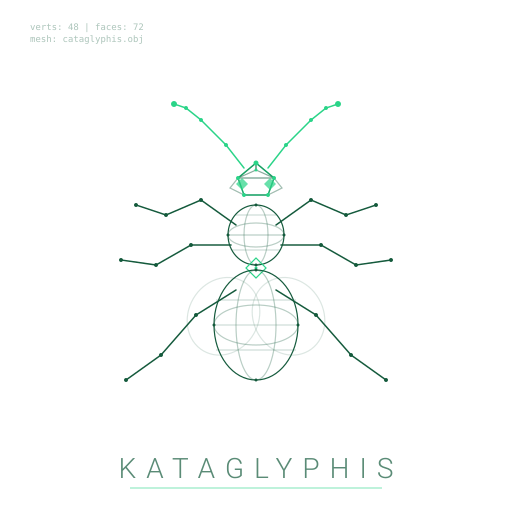
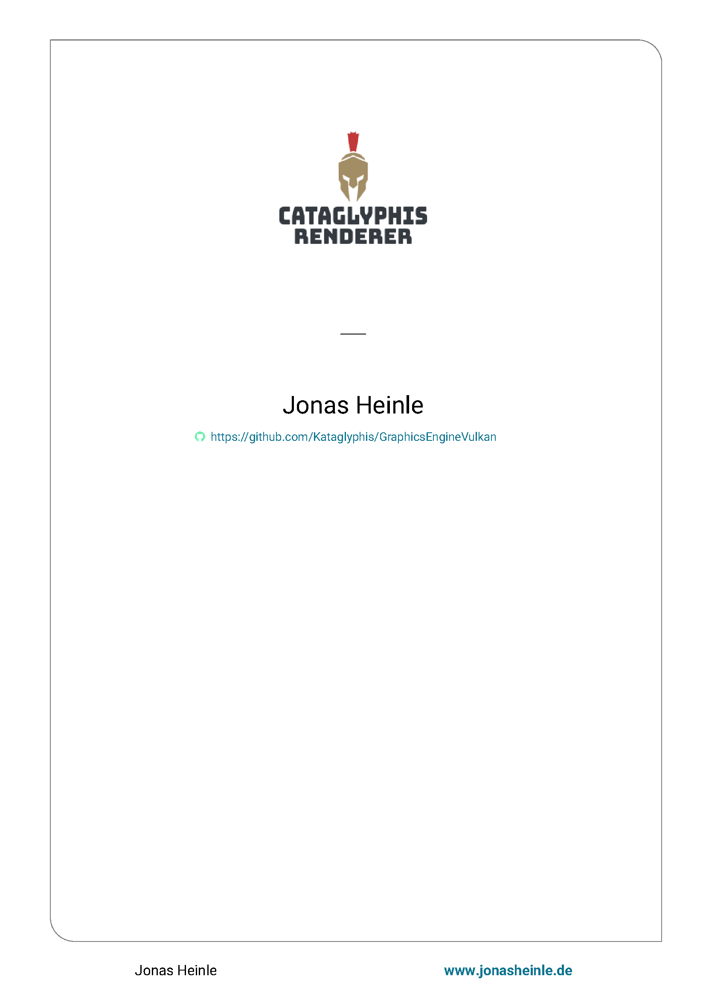
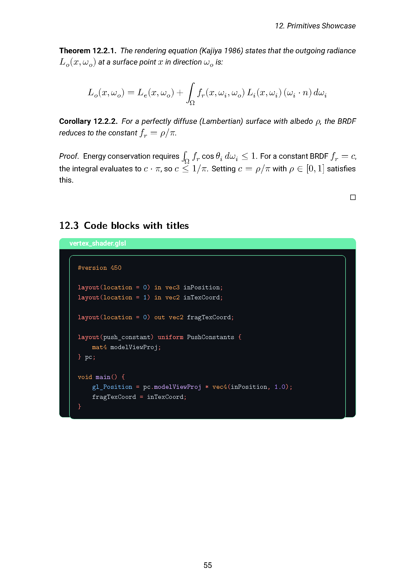
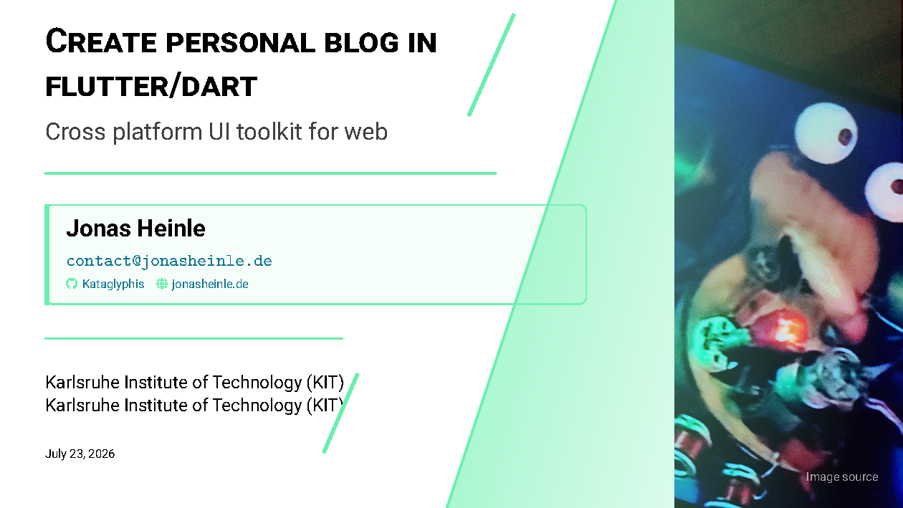
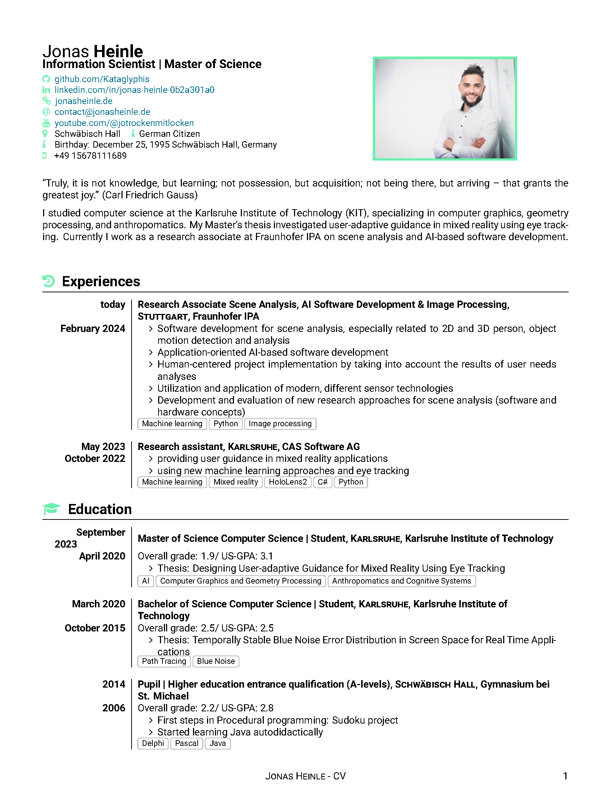

<div align="center">
  <a href="https://jonasheinle.de">
    
  </a>

  <h1>DocumANTation</h1>

  <h4>One brand, one toolchain → book, slides, PowerPoint, CV and a docs site. Containerized, reproducible, pixel-perfect.</h4>
</div>

[](https://github.com/Kataglyphis/DocumANTation/actions/workflows/linux-x64.yml)
[](https://github.com/Kataglyphis/DocumANTation/actions/workflows/docs.yml)

[**Docs site**](https://kataglyphis.github.io/DocumANTation/)

Formulate everything in Markdown, use LaTeX's power through Pandoc, and build it in one
container. A print-ready book, a Beamer slide deck, a PowerPoint deck, a bilingual CV, a
primitives showcase and a Sphinx docs site all take their colours, fonts, code-block palette
**and author details** from a single `style/brand.json`: change one value, run
`generate_style.py --write`, and every output rebrands at once. The same brand ships as
`sphinx-kataglyphis-theme`, the theme the Kataglyphis docs sites use.

<p align="center">
  <a href="images/book-title.png"></a>
  <a href="images/book-page.png"></a>
  <a href="images/beamer-slide.png"></a>
  <a href="images/cv-page.png"></a>
</p>

## Highlights

- **Slides and deck from one source**: `data/presentation/` renders to Beamer and to pptx, so the two cannot disagree.
- **Brand-consistent code blocks**: `brand.json` → Pandoc, Pygments, LaTeX and CSS, the same dark palette everywhere.
- **Identity is a token too**: author, URL, GitHub handle and institute are generated, never retyped.
- **Containerized builds**: one Dockerfile, pinned Pandoc (SHA256-verified) and uv; the host needs only a container runtime.
- **Strict build gates**: `STRICT_WARNINGS=1` turns Pandoc and LaTeX warnings into failures, locally, since CI compiles no LaTeX.
- **Bilingual CV from one source**: `CV_LANG=english|german`, with cover letters in the same class.

## Quick start

```bash
git clone --recurse-submodules --branch develop https://github.com/Kataglyphis/DocumANTation.git
cd DocumANTation
nerdctl build . -t pandoc_all            # once; BuildKit must be running
./scripts/build_in_container.sh book     # or beamer, demo, example, pptx, cv, letter
```

Everything lands in `data/out/`. With `make` installed, `make book` (and every other target)
does the same. Prerequisites, every target, live rebuilds and the docs site:
[docs/getting-started.md](docs/getting-started.md).

## Documentation

| Topic | Read |
| --- | --- |
| What each output looks like | [docs/gallery.md](docs/gallery.md) |
| Layout, document types, features, and why not just Pandoc | [docs/overview.md](docs/overview.md) |
| Prerequisites, every target, live demo mode, the docs site | [docs/getting-started.md](docs/getting-started.md) |
| The Pandoc and LuaLaTeX stages of each target | [docs/build-pipeline.md](docs/build-pipeline.md) |
| Tooling, the image's dependencies and their pins | [docs/project-info.md](docs/project-info.md) |
| The brand and the files generated from it | [style/README.md](style/README.md) |
| CV profiles and cover letters | [data/cv/README.md](data/cv/README.md) |
| The Sphinx templates downstream repositories consume | [docs-tooling/README.md](docs-tooling/README.md) |
| Reporting a vulnerability | [SECURITY.md](SECURITY.md) |
| Rules for agents and contributors | [AGENTS.md](AGENTS.md) |

## Contributing and contact

DocumANTation is one of the [Kataglyphis repositories](https://github.com/Kataglyphis/ANTfrastructure/blob/develop/docs/repository-family.md),
which share one way to contribute and one contact. Licence: MIT, see [LICENSE](LICENSE).
